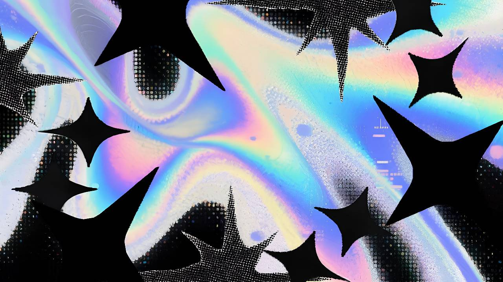

  
  

    

  

 

---

### 𓏴 ࣪ about me ∿

 

  <em>I like things that feel quiet.</em> 
  Soft color systems, calm frontends, and interfaces that don’t shout. 
  Building small, intentional pieces — one commit at a time.

 

  
  &nbsp;&nbsp;&nbsp;&nbsp;
  
  &nbsp;&nbsp;&nbsp;&nbsp;
  

 

---

### ⠀𓏵⠀ currently learning

 

  
  
  
  
  
  

  always learning something new  ⌒₊˚

 

---

### ౨ৎ what I care about

 

  soft palettes &nbsp;·&nbsp; low-contrast UIs &nbsp;·&nbsp; design systems 
  accessibility that feels natural &nbsp;·&nbsp; quiet, intentional code

 

---

### 𐔌 featured projects

things I’m building one commit at a time ( ⸝⸝´꒳`⸝⸝ )

 

  
  

  
  

 

| ⋆ | project | about |
|:-:|---------|-------|
| 💜 | **[lavender-theme](https://github.com/hoshiko9011/lavender-theme)** | Soft lavender VS Codethemes made for long, quiet sessions |
| 🎨 | **[Tintelya](https://github.com/hoshiko9011/Tintelya)** | Color studio — seed colors → full UI palette + WCAG + export |
| 🌿 | **[verdea](https://github.com/hoshiko9011/verdea)** | Calm plant shop · Next.js & TypeScript · [live](https://verdea-blue.vercel.app) |
| 🧸 | **[labkhand-nini](https://github.com/hoshiko9011/labkhand-nini)** | Baby & newborn store experiment · Next.js + Strapi |

 

  

 

---

### ⋆˙⟡ little stats

 

  
  &nbsp;
  

 

---

### ♫ currently listening

 

  

 

---

  

